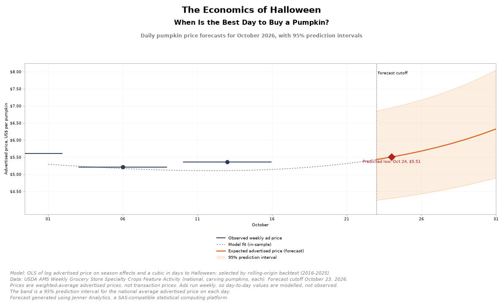
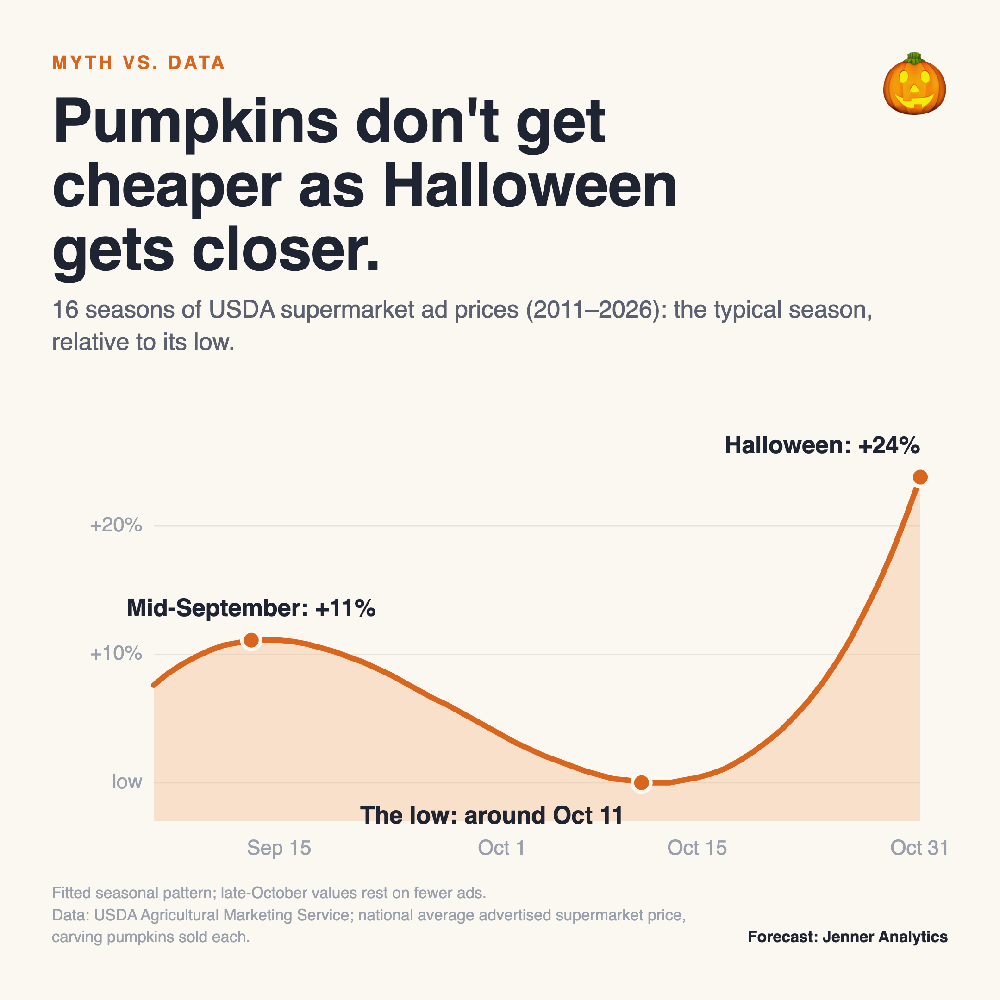
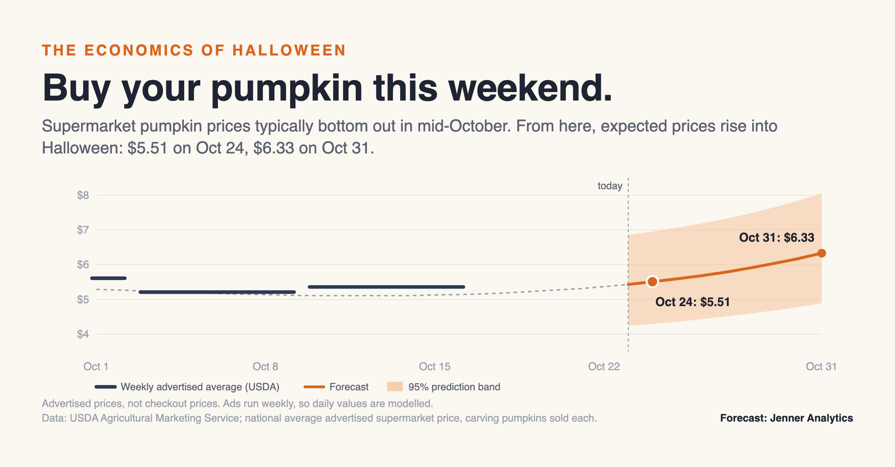
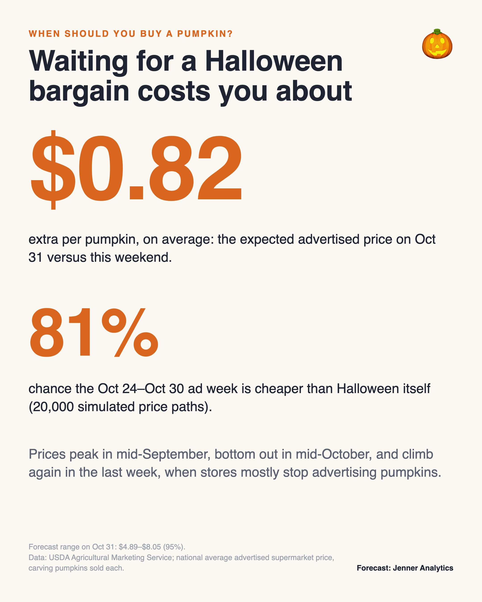

# The Economics of Halloween: when is the best day to buy a pumpkin?



**Short answer for 2026: buy this weekend.** US supermarket ad prices for carving pumpkins typically bottom out in mid-October and rise into Halloween. As of the latest USDA report (the ad week of 10-16 October), our forecast is:

| | Expected advertised price | 95% prediction interval |
|---|---|---|
| Saturday 24 October (predicted cheapest remaining day) | **$5.51** | $4.30 - $6.95 |
| Halloween, Saturday 31 October | **$6.33** | $4.89 - $8.05 |

Across 20,000 simulated price paths, the ad week of 24-30 October was cheaper than Halloween itself **81%** of the time. Waiting costs about **$0.82** per pumpkin in expectation.

The whole analysis is SAS-compatible code run on [Jenner Analytics](https://jenneranalytics.com): import, cleaning, five model families, rolling-origin backtests, the forecast, a simulation and the chart. The programs use standard SAS syntax.

> **What this is, and isn't.** The target is the *national store-weighted average advertised supermarket price* of a conventional carving pumpkin sold each (USDA AMS). Ads run for a week, so the daily curve is modelled, not observed. Farm stands and pumpkin patches are not covered, and neither are unadvertised last-minute markdowns.

## Findings

1. **No Halloween discount in the ads.** Across 16 seasons (2011-2026), advertised prices peak in mid-September (about 11% above the low), bottom out around 11-16 October, and rise in the final week, about 24% above the low by 31 October. The cubic terms for days-to-Halloween are jointly significant (p < 0.001). The late-October estimate rests on fewer ads: retailers mostly stop advertising pumpkins in the final week.
2. **Stores cut prices when people are searching.** Within a season, weeks with more Google searches for "pumpkin patch" have *lower* advertised prices (Spearman rho = -0.31, p < 0.001; OLS -0.0024 per index point, p = 0.026). This fits retailers featuring pumpkins as a traffic driver at peak demand.
3. **Wholesale prices don't predict ad prices.** Daily terminal-market prices for Howden pumpkins in 36-inch bins, lagged one week, add nothing (p = 0.71).
4. **Harvest size doesn't explain cheap years.** Season price levels show no association with national production (p = 0.40, 15 seasons).
5. **Regions differ.** In a PROC MIXED model of six USDA regions, price levels vary by region (random-effect SD about 5%; F = 6.14, p < 0.001). The within-season pattern also differs by region (region × days-to-Halloween, p = 0.015). The national forecast describes the average shopper, not every region.

These are associations, not causal effects.



## Models and validation

| Model | Specification | Jenner procedure |
|---|---|---|
| Naive | last observed price persists | DATA step, PROC SQL |
| A0 | season effect only (flat season) | PROC GLM |
| A1-A3 | season effect + polynomial (degree 1-3) in days to Halloween | PROC GLM, PROC GLMSELECT |
| B1 | season effect + smoothing spline in days to Halloween | PROC GAM |
| B2/B3 | B1 + lagged wholesale price + search interest | PROC GAM, PROC GLM |
| C | daily latent price level (random walk) + seasonal regression, observed at ad-week midpoints | PROC UCM |
| D | regional model with random region and region-by-season effects | PROC MIXED |

Each model was backtested on seasons 2016-2025 from two forecast origins, 30 September and 21 October. Every forecast uses only reports published by its origin date.

| Model | RMSE, 21 Oct origin | 95% coverage | RMSE, 30 Sep origin | 95% coverage | Cheapest week found (21 Oct) |
|---|---|---|---|---|---|
| A3 cubic | $0.48 | 100% | $0.50 | 98% | 90% |
| C state space (UCM) | $0.51 | 82% | $0.50 | 40% | 60% |
| B1 GAM | $0.56 | 94% | $0.56 | 96% | 80% |
| A2 quadratic | $0.65 | 94% | $0.64 | 98% | 80% |
| A0 flat season | $0.69 | 94% | $0.65 | 96% | 90% |
| A1 linear | $0.70 | 94% | $0.67 | 96% | 70% |
| Naive | $0.95 | 100% | $0.61 | 100% | n/a |

**Selected model: A3** (OLS of log price on season effects and a cubic in days to Halloween). It had the lowest RMSE from the 21 October origin, which matches this forecast. From 30 September it tied with the state-space model ($0.50), but the state-space model's 95% intervals covered only 40% of outcomes; A3's covered 98%. More complex models did not forecast better. Full details are in [docs/methodology.md](docs/methodology.md).

## Images for sharing

| | |
|---|---|
|  |  |

`scripts/make_social_cards.py` builds these from the forecast CSVs. The chart at the top is drawn by PROC SGPLOT (SVG, PNG, PDF in `output/figures/`).

## Reproduce

```bash
export PUMPKIN_ROOT="$(pwd)" JENNER_UNLIMITED=1
jenner run_all.sas -log logs/run_all.log -print output/tables/run_all.lst
```

`./run_step.sh 08_forecast` runs one step. To refresh the data:
- NASS: `scripts/fetch_nass.sh`
- USDA MyMarketNews and Google Trends block scripted clients, so `scripts/fetch_mmn_console.js` and `scripts/fetch_trends_console.js` run from a browser console.

The forecast cutoff, store threshold and random seed are set in `config/settings.sas`.

| Path | Contents |
|---|---|
| `sas/01_import.sas` ... `sas/09_visualization.sas` | the pipeline, in order |
| `data/raw/` | source data as downloaded (USDA AMS retail and terminal markets, USDA NASS, Google Trends) |
| `data/processed/model_weekly.csv` | the modeling dataset |
| `output/forecasts/pumpkin_price_forecast_oct2026.csv` | the daily forecast with 95% intervals and observed/inferred/forecast status |
| `output/tables/` | model comparison, backtest detail, season profile, SAS listings |
| `docs/` | [data inventory](docs/data_inventory.md), [methodology](docs/methodology.md), [public summary](docs/public_summary.md) |

## Data sources and attribution

- USDA Agricultural Marketing Service, Market News: *Weekly Grocery Store Specialty Crops Feature Activity* (FVWRETAIL) and terminal-market vegetable reports. Public domain.
- USDA National Agricultural Statistics Service, Quick Stats. Public domain.
- Source: Google Trends (www.google.com/trends).

Code is MIT-licensed (see [LICENSE](LICENSE)). Forecast generated using Jenner Analytics, a SAS-compatible statistical computing platform.
