# The Economics of Thanksgiving: when is the best time to buy a turkey?

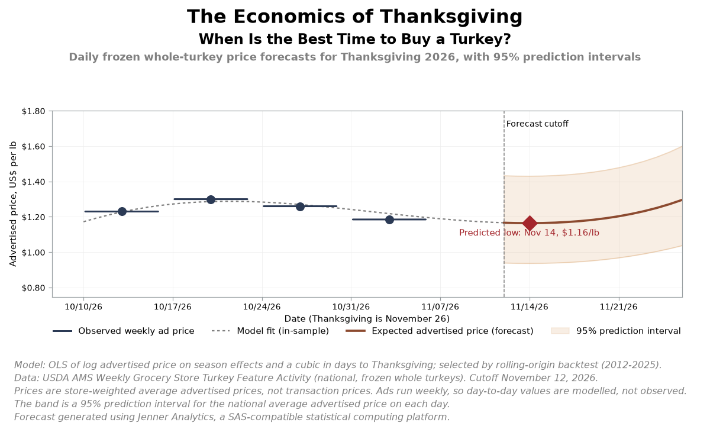

**Short answer for 2026: buy in the next week or so; don't wait for Thanksgiving week.** US supermarket ad prices for frozen whole turkeys typically bottom out in mid-November, about two weeks before the holiday, and are higher again in Thanksgiving week. The latest USDA report (ad week 31 October - 6 November) put the national average at $1.19 per lb, down from $1.26 the week before. Our forecast:

| | Expected advertised price | 95% prediction interval |
|---|---|---|
| Saturday 14 November (predicted cheapest day) | **$1.16 / lb** | $0.94 - $1.43 |
| Wednesday 25 November, the day before Thanksgiving | **$1.27 / lb** | $1.02 - $1.57 |

On a 16-lb bird, waiting until the day before Thanksgiving costs about **$1.72** in expectation. Across 20,000 simulated price paths, this week's price beat Thanksgiving week's **79%** of the time.

The whole analysis is SAS-compatible code run on [Jenner Analytics](https://jenneranalytics.com): import, cleaning, five model families, rolling-origin backtests, the forecast, a simulation, the chart above and the social cards below. Every step is a `.sas` program using standard SAS syntax; there is no other code in this folder.

> **What this is, and isn't.** The target is the *national store-weighted average advertised supermarket price* of a conventional frozen whole turkey, per lb (USDA AMS). Ads run for a week, so the daily curve is modelled, not observed. Loyalty-card prices, coupons and "free turkey with purchase" offers are not covered, and neither are fresh, organic or kosher birds.

## Findings

1. **The best ad prices come before Thanksgiving week.** Across 22 seasons (2005-2026), advertised prices are about 11% above the low in late October, bottom out roughly 12 days before Thanksgiving, and are about 11% above the low again by Thanksgiving Day. The cubic term for days-to-Thanksgiving is significant (p < 0.001). In 16 of 21 completed seasons the Thanksgiving-week price was higher than the price two ad weeks earlier, by 8% on average.
2. **The turkey is a loss leader.** In the three ad weeks through Thanksgiving, supermarkets advertised frozen turkeys 44% below the wholesale price in 2022 and again in 2025. Wholesale frozen hens ranged from $0.96 to $1.75 per lb over 2022-2025; the retail ad price stayed between $0.95 and $1.11. Wholesale is about $1.80 this season.
3. **More ads, lower prices.** Within a season, weeks when more stores advertise turkeys have *lower* advertised prices (Spearman rho = -0.33, p < 0.001; elasticity -0.05, p < 0.001). About 2,400 stores advertise frozen turkeys a month before Thanksgiving and 32,000 the week before Thanksgiving week.
4. **Fresh costs about 75% more.** In the two ad weeks through Thanksgiving, fresh whole turkeys are advertised 75% above frozen on average (paired t = 32.7), and about 90% above in recent seasons: $1.85 against $0.97 per lb in 2025.
5. **Regions differ.** In a PROC MIXED model of six USDA regions, price levels vary by region (F = 3.59, p = 0.004), from $0.87 per lb in the Southeast to $1.02 in the Northwest. The within-season pattern also differs by region (region × days-to-Thanksgiving, p = 0.006). The national forecast describes the average shopper, not every region.

These are associations, not causal effects.

| | |
|---|---|
| 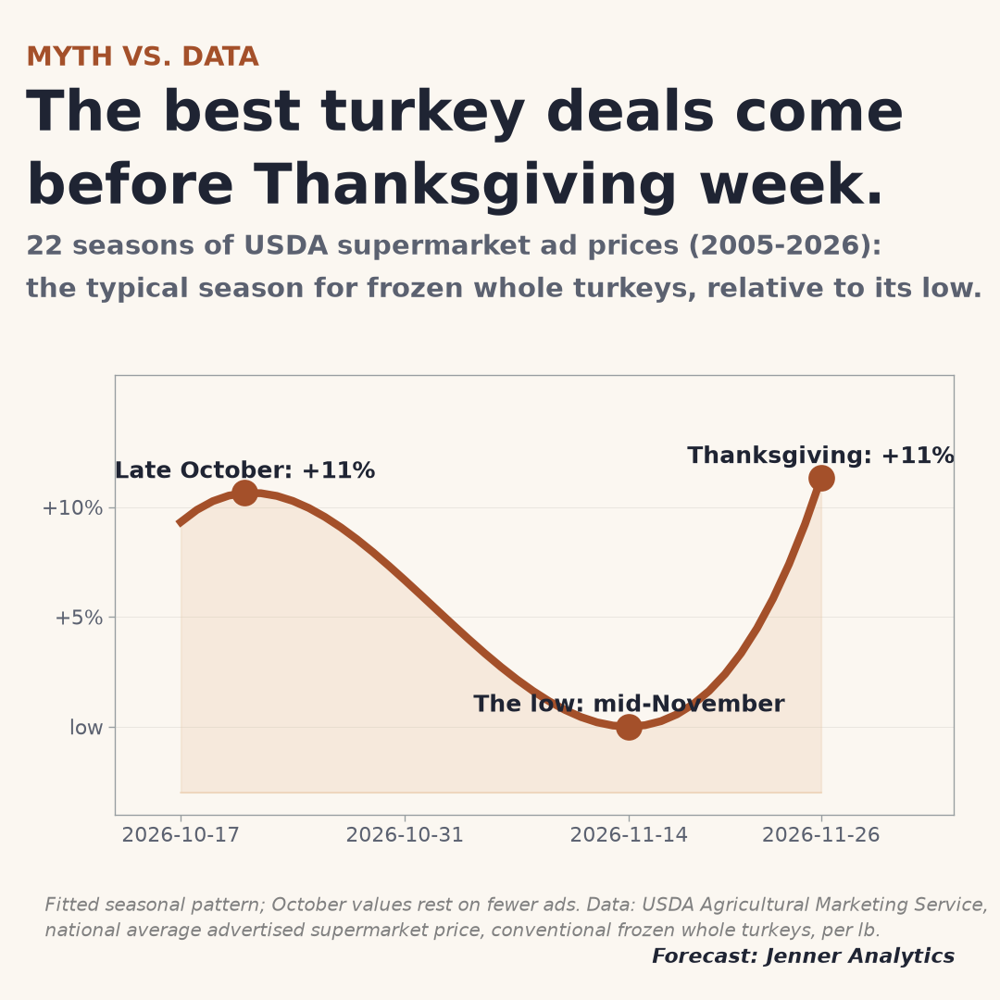 | 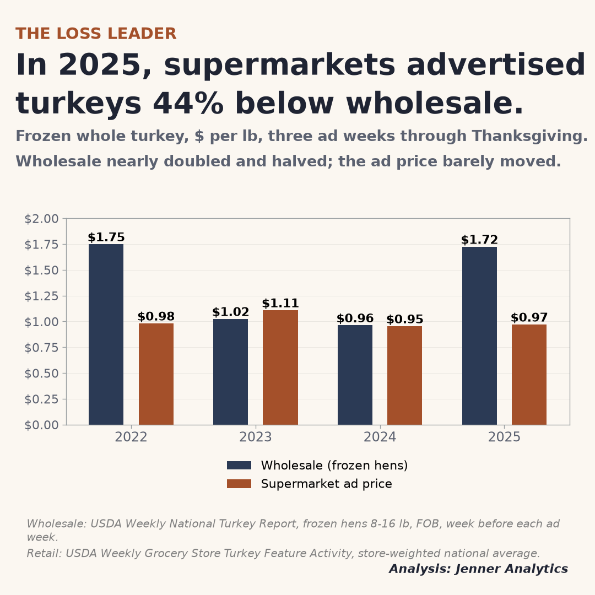 |

## Beyond the average: when the cheapest turkeys appear

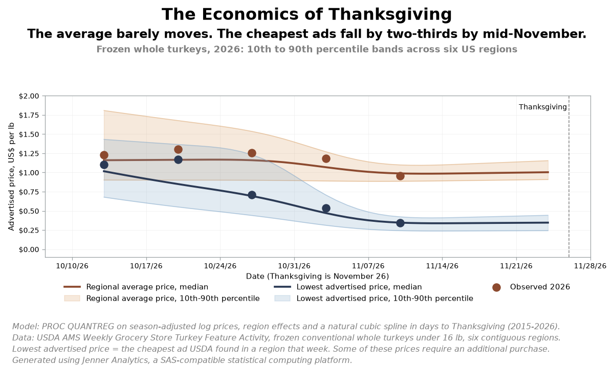

The forecast above is about the *average* advertised price. A shopper hunting for a deal cares about the low end, and the low end behaves differently. USDA also reports the lowest and highest advertised price in each of its regions each week, so the spread can be modelled as well (575 region-weeks, 2015-2026, through the ad week of 7-13 November 2026).

1. **The average moves by cents; the cheapest ad moves by two-thirds.** Six weeks before Thanksgiving the cheapest ad in a region is typically $1.02 per lb, about the same as the average. By mid-November it is $0.35 and it stays there through Thanksgiving week. Over the same weeks the regional average goes from $1.16 to $0.99.
2. **The deals start about four weeks out and are everywhere two weeks out.** The share of region-weeks with an ad at or below $0.50 per lb is 5% five weeks before Thanksgiving week, 16% four weeks before, 48% three weeks before and 86-91% in the two weeks before Thanksgiving week.
3. **Prices spread out inside a region as they converge between regions.** The highest advertised price in a region is 1.1 times the lowest six weeks out and 5.6 times the lowest the week before Thanksgiving week. Between regions the opposite happens: the standard deviation of the log regional average falls from 0.36 to 0.11 as more stores advertise.
4. **Regions differ at the low end.** In the ad week of 7-13 November 2026 the cheapest ad was $0.24 per lb in the Southeast and $0.29 in the Northeast, against $0.58 in the Northwest.

| | |
|---|---|
| 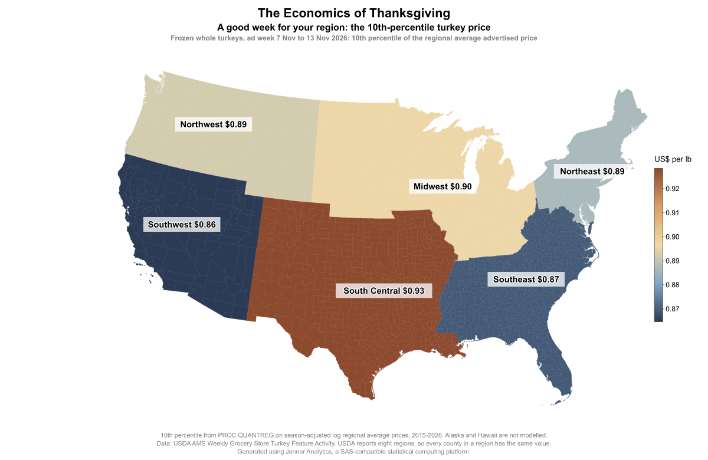 | 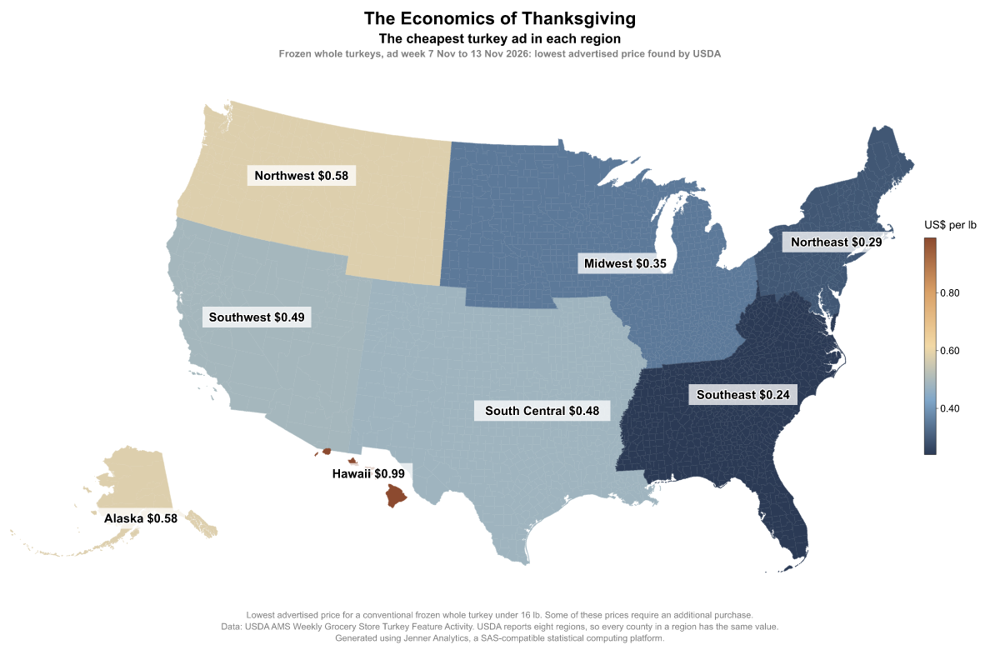 |

The percentile curves come from PROC QUANTREG (10th, 50th and 90th percentiles of season-adjusted log prices, with region effects and a spline in days to Thanksgiving). The variance model is PROC AUTOREG with a HETERO statement. The maps are drawn with PROC SGMAP on county boundaries. USDA publishes these prices for eight regions, so every county in a region has the same value.

Read these limits before using the numbers:

- **These are not percentiles across stores.** USDA publishes a low, an average and a high for each region, not store-level prices. The 10th percentile here is across region-weeks: a good week for a region, not a cheap store in it.
- **The cheapest ads often have strings attached.** USDA notes that some of the lowest prices require an additional purchase, typically of $20 to $50.
- **The low end is harder to predict than the average.** In a backtest on seasons 2019-2025 from 14 days before Thanksgiving, 15-31% of outcomes fell below the predicted 10th percentile, against a target of 10%, for quantile regression and for two normal models alike. Prices late in the season fell further than the early weeks of the season suggested. Quantile regression was not clearly better than the normal models.

Details are in [docs/methodology.md](docs/methodology.md#price-spread-and-quantiles).

## Models and validation

| Model | Specification | Jenner procedure |
|---|---|---|
| Naive | last observed price persists | DATA step, PROC SQL |
| A0 | season effect only (flat season) | PROC GLM |
| A1-A3 | season effect + polynomial (degree 1-3) in days to Thanksgiving | PROC GLM, PROC GLMSELECT |
| B1 | season effect + smoothing spline in days to Thanksgiving | PROC GAM |
| B2 | A2 + log number of advertising stores | PROC GLM |
| C | daily latent price level (random walk) + seasonal regression, observed at ad-week midpoints | PROC UCM |
| D | regional model with random region and region-by-season effects | PROC MIXED |

Each model was backtested on seasons 2012-2025 from two forecast origins, 26 and 14 days before Thanksgiving. Every forecast uses only reports published by its origin date.

| Model | RMSE, 14 days out | 95% coverage | RMSE, 26 days out | 95% coverage |
|---|---|---|---|---|
| C state space (UCM) | $0.091 | 97.5% | $0.105 | 69.6% |
| A1 linear | $0.112 | 97.5% | $0.163 | 91.1% |
| B1 GAM | $0.112 | 95.0% | $0.151 | 91.1% |
| A3 cubic | $0.113 | 95.0% | $0.150 | 92.9% |
| Naive | $0.115 | 100% | $0.181 | 98.2% |
| A0 flat season | $0.116 | 95.0% | $0.168 | 91.1% |
| A2 quadratic | $0.121 | 95.0% | $0.166 | 91.1% |

**Selected model: A3** (OLS of log price on season effects and a cubic in days to Thanksgiving). The state-space model has the lowest point error, but its 95% intervals covered only 70% of outcomes from the earlier origin, so it is kept as a cross-check. Among the models with reliable intervals, A1, B1 and A3 are tied 14 days out and A3 is best 26 days out.

Read the table before trusting the forecast:

- Two weeks out, no model beats "the price stays where it is" by much ($0.113 against $0.115). Most of what is known is this season's price level.
- No model picks the single cheapest remaining week in more than half of the seasons.
- The state-space cross-check forecasts a flatter 2026 path: about $1.15 per lb from 13 November through Thanksgiving, rising by under one cent. Both models put the low in mid-November, and neither shows a gain from waiting. They disagree on how much waiting costs.

Full details are in [docs/methodology.md](docs/methodology.md).

## Images for sharing

| | |
|---|---|
| 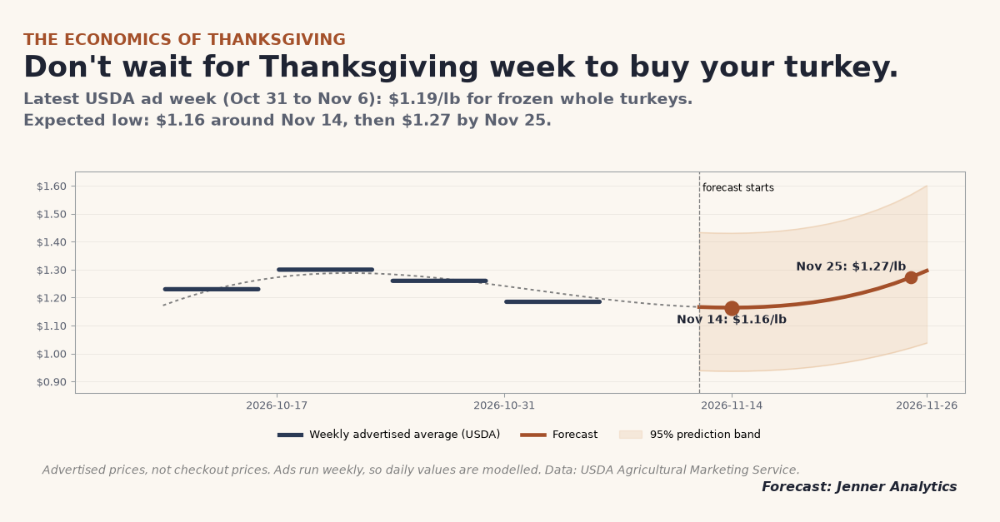 | 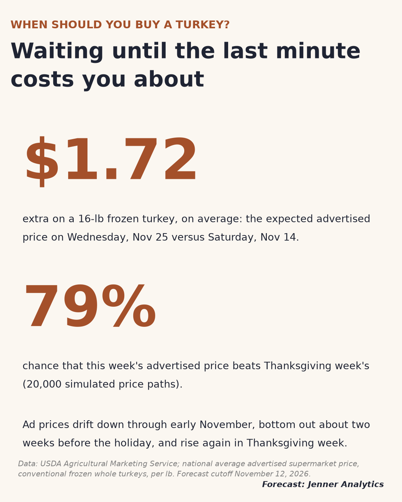 |
| 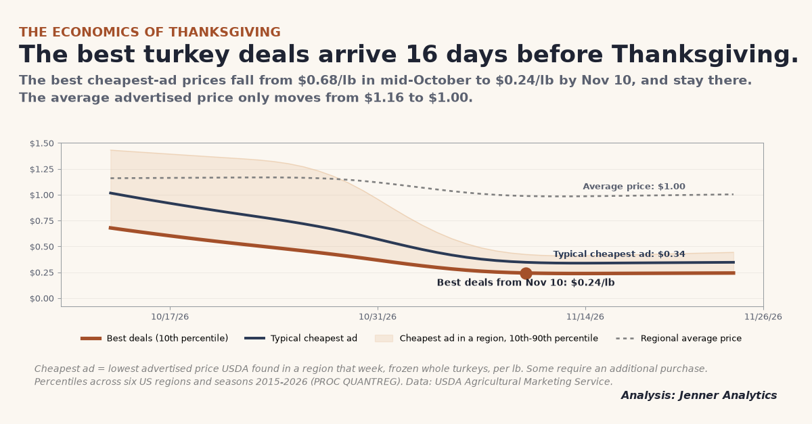 | 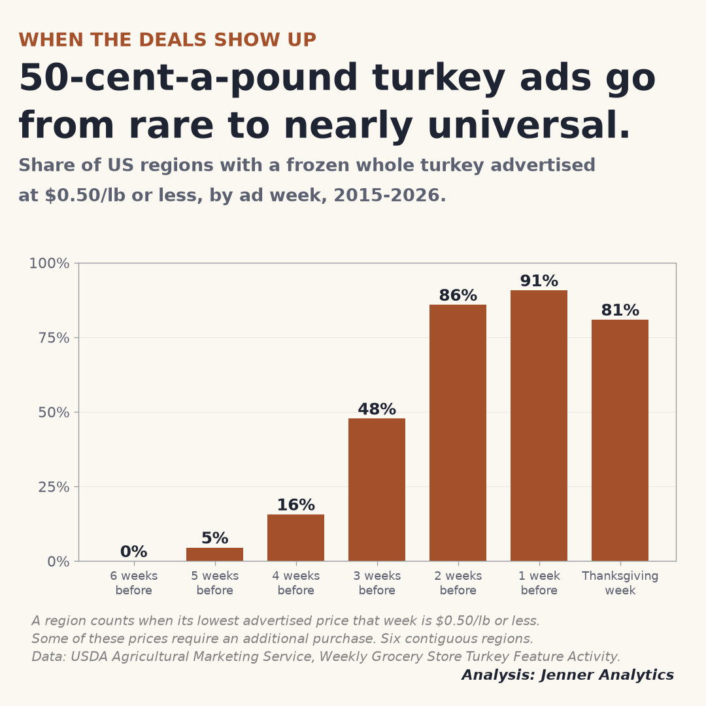 |
| 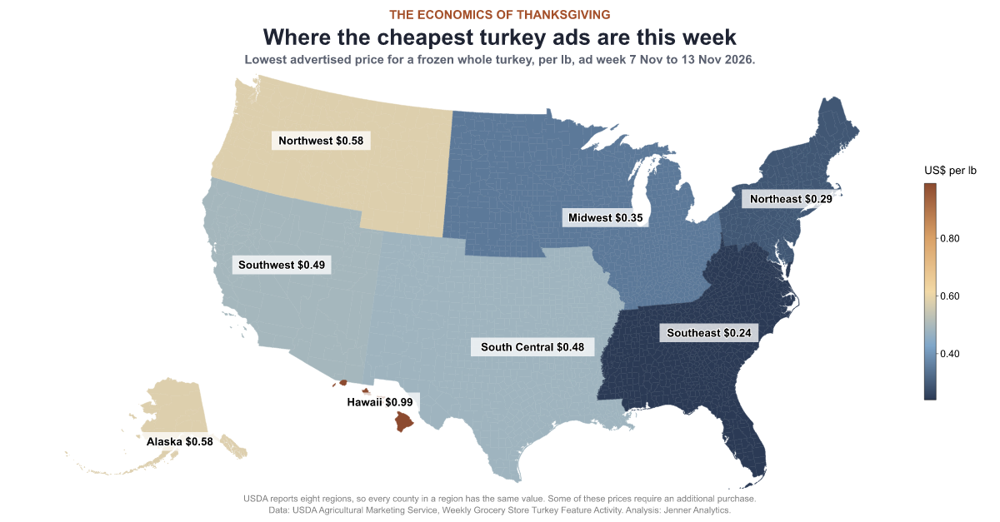 | |

`sas/10_social_cards.sas` draws the four forecast cards with PROC SGPLOT from the forecast tables, and `sas/13_deal_cards.sas` draws the three deal cards from the price-spread tables. The chart at the top is drawn by `sas/09_visualization.sas` (SVG, PNG, PDF in `output/figures/`). Suggested post text is in [output/social/post_copy.md](output/social/post_copy.md).

## Reproduce

```bash
export TURKEY_ROOT="$(pwd)" JENNER_UNLIMITED=1
jenner run_all.sas -log logs/run_all.log -print output/tables/run_all.lst
```

The price-spread analysis needs only the raw data and runs on its own in a few minutes:

```bash
jenner run_spread.sas -log logs/run_spread.log -print output/tables/price_spread.lst
```

The backtest (`sas/07_validation.sas`) fits 28 state-space models and takes most of the run time. The forecast cutoff, store threshold, season window, backtest seasons and random seed are set in `config/settings.sas`. USDA publishes each ad week on the Friday it ends: to refresh, add the new rows to the files in `data/raw/`, move `cutoff`, and run again.

| Path | Contents |
|---|---|
| `sas/01_import.sas` ... `sas/13_deal_cards.sas` | the pipeline, in order |
| `data/raw/` | source data (USDA AMS retail feature activity, national and regional; USDA AMS wholesale) |
| `data/processed/model_weekly.csv` | the modeling dataset |
| `output/forecasts/turkey_price_forecast_thanksgiving2026.csv` | the daily forecast with 95% intervals and observed/inferred/forecast status |
| `output/tables/` | model comparison, backtest detail, season profile, loss-leader table, `run_all.lst`, the SAS listing of steps 01 to 10, and the price-spread tables with their listing, `price_spread.lst` |
| `output/social/` | cards for sharing and post text |
| `docs/` | [data inventory](docs/data_inventory.md), [methodology](docs/methodology.md), [public summary](docs/public_summary.md) |

## Data sources and attribution

- USDA Agricultural Marketing Service, Market News: *Weekly Grocery Store Turkey Feature Activity* and *Weekly National Turkey Report*. Public domain.

Code is MIT-licensed (see [LICENSE](LICENSE)). Forecast generated using Jenner Analytics, a SAS-compatible statistical computing platform.
